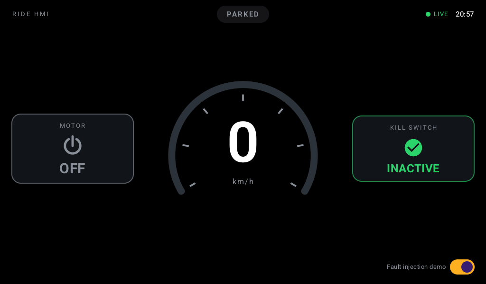
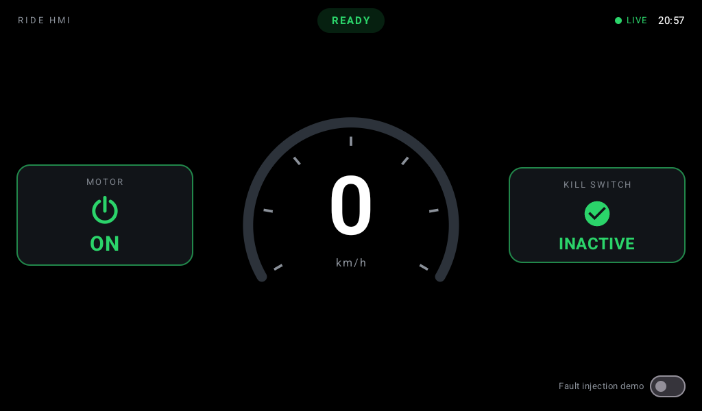
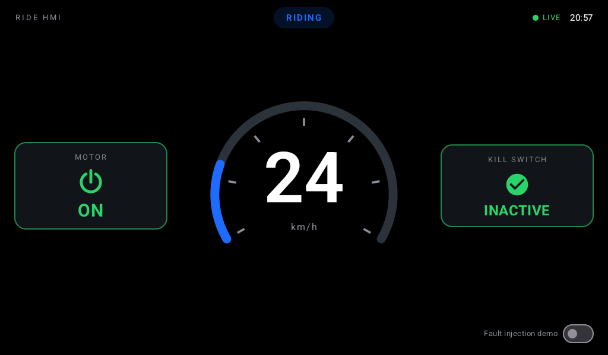
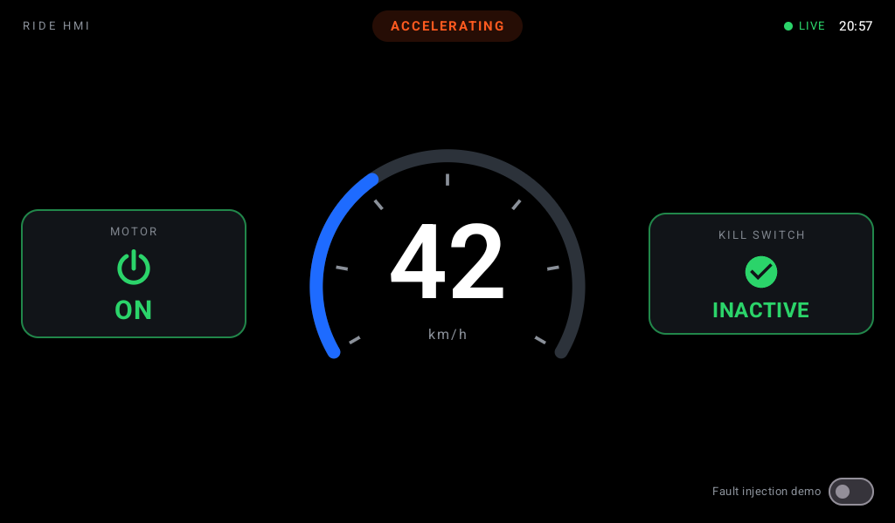
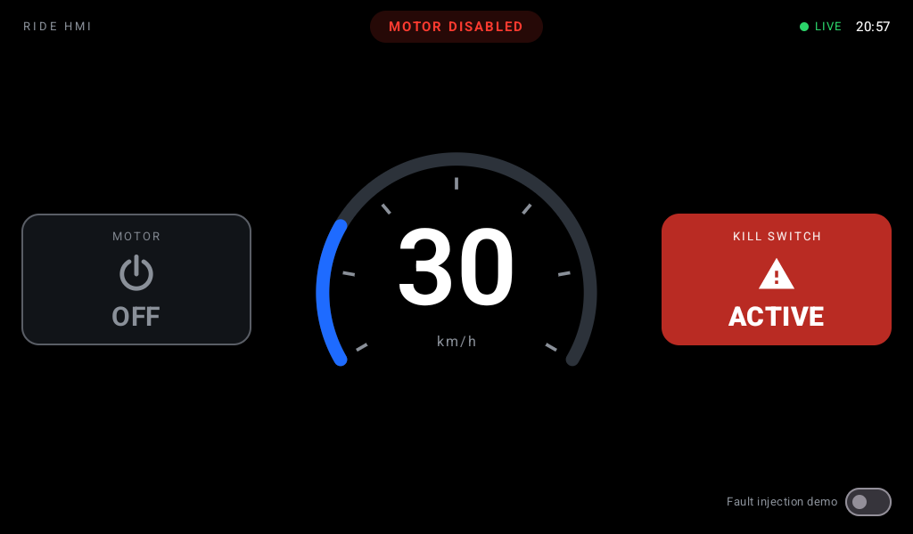

# Ride HMI – Landscape Home/Ride Dashboard

**Author:** Akash Chaurasia · akashenf118@gmail.com

A landscape Android HMI dashboard that shows **vehicle speed (km/h)**, **motor status (ON/OFF)** and
**kill-switch status (Active/Inactive)**. A simulated vehicle feed drives it reactively, built with
Kotlin, Jetpack Compose, Coroutines/Flow, MVVM, Clean Architecture and Hilt.

## Screenshots

All five required scenarios, updating automatically from the simulated feed:

| Parked | Ready |
|---|---|
|  |  |

| Riding | Accelerating |
|---|---|
|  |  |

**Motor disabled (kill switch active)**



## Build & run

**Requirements:** Android Studio Ladybug or newer (or just the Android SDK), JDK 17, Android SDK 35.

```bash
# macOS/Linux only, if the project was downloaded as a ZIP
chmod +x gradlew

# Build a debug APK
./gradlew assembleDebug

# Install and launch on a running emulator/device
./gradlew installDebug
adb shell am start -n com.hmi.ridedashboard/.MainActivity
```

Or open the project in Android Studio and run the `app` configuration. The activity is locked to
landscape (`sensorLandscape`), hides the system bars and keeps the screen on.

> Verified on an emulator at 1024×600 (a typical cluster/HMI resolution).

## Running the tests

```bash
./gradlew testDebugUnitTest
```

HTML report: `app/build/reports/tests/testDebugUnitTest/index.html`

| Test class | What it covers |
|---|---|
| `ObserveVehicleStateUseCaseTest` | The 5-scenario sequence maps to the right states; invalid/missing signals don't break the stream; **stale detection** after 2.5 s of silence and recovery; **source failure → LOST → retry** |
| `DashboardViewModelTest` | `uiState` updates reactively from the feed, invalid speed and stale feed shown as degraded, gauge clamping, fault-injection toggle |
| `SpeedValidatorTest` | Negative, NaN, ±Infinity, out-of-range, sensor-noise and missing speed values |
| `RideStateResolverTest` | Parked / Ready / Riding / Accelerating / Motor-disabled, coasting, unknown inputs |
| `SimulatedVehicleDataSourceTest` | Simulator emits all five scenarios at exactly one frame per second (virtual time), fault frames and dropout gap |

All tests use `kotlinx-coroutines-test` virtual time, so they run in milliseconds and don't flake.

## Architecture

Single Gradle module, layered by package (multiple modules weren't required). Dependencies point
inward: **presentation → domain ← data**.

```
com.hmi.ridedashboard
├── presentation/            UI + ViewModel (Compose, StateFlow)
│   ├── dashboard/           DashboardScreen, DashboardViewModel, DashboardUiState
│   │   └── components/      Speedometer, MotorStatusCard, KillSwitchCard, TopBar, SignalBanner
│   └── theme/
├── domain/                  Pure Kotlin business rules, no Android imports
│   ├── model/               VehicleSignal (raw), VehicleState (validated), enums
│   ├── repository/          VehicleRepository, SimulationController (interfaces)
│   └── usecase/             ObserveVehicleStateUseCase, SpeedValidator, RideStateResolver, fault toggles
├── data/
│   ├── source/              VehicleDataSource interface + DTO
│   ├── simulator/           SimulatedVehicleDataSource, ScenarioScript
│   └── repository/          VehicleRepositoryImpl, SimulationControllerImpl
└── di/                      Hilt modules (bindings, dispatchers, timing config)
```

### Data flow

```
SimulatedVehicleDataSource  ──Flow<VehicleSignalDto>──▶  VehicleRepositoryImpl
   (1 frame / second)                                    │ maps DTO → domain VehicleSignal
                                                         ▼
                                         ObserveVehicleStateUseCase
                                           • validate speed            (SpeedValidator)
                                           • map nullable → UNKNOWN
                                           • derive ride state          (RideStateResolver)
                                           • stale timeout              (transformLatest + delay)
                                           • source errors → LOST + retry (retryWhen)
                                                         │ Flow<VehicleState>
                                                         ▼
                              DashboardViewModel ── combine + stateIn ──▶ StateFlow<DashboardUiState>
                                                         │ collectAsStateWithLifecycle()
                                                         ▼
                                                  DashboardScreen (Compose)
```

* **Unidirectional data flow:** the UI only renders `DashboardUiState` and sends events back
  (`onFaultInjectionToggled`).
* **`SharingStarted.WhileSubscribed(5s)`** keeps the feed alive across rotation and stops it
  when the app goes to the background.
* **Hilt** wires everything. Moving to real hardware means replacing one binding in `DataModule`
  (`VehicleDataSource` → a CAN/VHAL-backed implementation). Nothing above the data layer changes.
* The simulator never sends a "scenario" label. The domain **infers** the ride state from the raw
  signals, so the same logic would work on real bus data.

## Vehicle data simulation

`ScenarioScript.nominal` loops forever, one frame per second:

| Step | Speed | Motor | Kill switch | Ticks | Ride state shown |
|---|---|---|---|---|---|
| Parked | 0 | OFF | Inactive | 3 | PARKED |
| Ready | 0 | ON | Inactive | 3 | READY |
| Riding | 25 | ON | Inactive | 4 | RIDING |
| Accelerating | 35 → 45 → 50 | ON | Inactive | 3 | ACCELERATING |
| Motor disabled | 30 → 10 → 0 | OFF | **Active** | 5 | MOTOR DISABLED |

*Documented deviation:* in the motor-disabled step the vehicle **coasts down** (30 → 10 → 0) and
doesn't drop to 0 instantly. The brief notes that motor OFF doesn't force speed to zero. The final
frames match the specified state exactly (0 km/h, motor OFF, kill switch Active).

### Fault-injection demo

Use the **"Fault injection demo"** switch (bottom right). It restarts the script and appends:

| Step | Frame | What the UI does |
|---|---|---|
| Negative speed | `-12 km/h` ×2 | Amber `--` + "INVALID SPEED SIGNAL", ride state UNKNOWN |
| NaN speed | `NaN` | same |
| Out of range | `999 km/h` | same |
| Missing signals | all fields `null` ×2 | `--` "NO SPEED DATA", motor and kill switch show **N/A** |
| Signal dropout | no frames for 4 s | after 2.5 s: **STALE** badge, banner, dimmed last known values |

## Edge cases handled

1. **Invalid speed:** negative, NaN, infinite or above 160 km/h → `SpeedReading.Invalid`. Small
   negative noise (≥ −1 km/h) at standstill reads as 0.
2. **Missing signals:** any `null` field → `Unavailable` / `UNKNOWN`, shown as N/A and never as a
   misleading default such as "OFF".
3. **Stale data:** no frame within 2.5 s (2.5 missed ticks) → `SignalHealth.STALE`. Last known
   values stay on screen but dimmed, with a banner. The next frame restores LIVE.
4. **Source failure:** if the upstream flow throws, the state becomes `LOST` ("NO SIGNAL") and keeps
   its last values, then the use case retries every 2 s.
5. **Gauge overflow:** speeds above the 120 km/h gauge range clamp the arc and still show the
   real number.
6. **No data yet:** the app starts in `AWAITING` ("CONNECTING") and does not show fake zeros.

## UI notes

The design is loosely based on the reference dashboard: dark background, large central speed
readout (#20/#23) and a motor-status pill (#36).

* **Kill switch** uses four cues so the two states can't be confused: colour (solid red vs green
  outline), icon (warning vs check), weight, and motion (ACTIVE pulses).
* The speed number and arc **animate** between frames. The arc turns orange above 80 km/h.
* Ride-state pill at the top, signal-health indicator and clock at the top right.
* Accessibility: the speed, motor and kill-switch elements have content descriptions.

## Assumptions & limitations

* No real vehicle bus. `SimulatedVehicleDataSource` stands in for CAN/VHAL.
* "Accelerating" means speed rose by ≥ 3 km/h since the previous frame **while already moving**.
  Pulling away from standstill counts as Riding. Per-frame deltas are fine at 1 Hz. A real system
  would use filtered acceleration.
* The plausibility limit (160 km/h) and stale timeout (2.5 s) are configuration values in
  `SpeedValidator` / `ConfigModule`.
* Fault-injection and simulator controls exist only for the demo.
* No UI (instrumented) tests. The rules live in the domain layer, which unit tests cover.
* Strings are in `strings.xml` for localisation. Only English is provided.

## Tech stack

Kotlin 2.0.21 · Jetpack Compose (BOM 2024.12.01, Material 3) · Coroutines/Flow 1.9.0 · Lifecycle 2.8.7
· Hilt 2.52 (KSP) · AGP 8.7.3 / Gradle 8.13 · JUnit 4, kotlinx-coroutines-test, Turbine.
minSdk 26, target/compile SDK 35.
